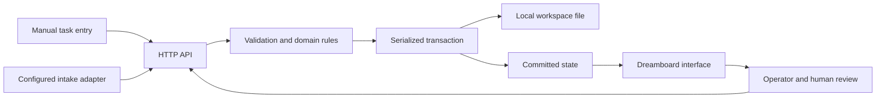

# Architecture and decisions

## Responsibilities

The intake adapter is an integration seam, not a currently connected production system.

## State machine

- Inbox → In progress: start work.
- In progress → In review: submit for review.
- In review → In progress: request changes with non-empty feedback.
- In review → Done: explicit human approval.
- In progress → Done: allowed only when the task was created without a review requirement.
- Done → In progress: reopen, clear the previous approval.

Completed tasks cannot be edited until reopened. Comments remain possible in any state and increment the version to maintain a consistent activity sequence.

## Decisions

### Domain rules stay on the server

The browser shows available actions, but the domain layer enforces transitions. Manually calling the API cannot skip required review.

### Optimistic concurrency

Every task carries a monotonically increasing version. Writes must include the version the operator viewed. Mismatches return 409. This avoids silent lost updates without claiming a distributed locking system.

### Idempotency by source and external ID

Intake identity is scoped to the source. A normalized content fingerprint distinguishes a safe retry from reuse of an ID for a different request. Replays increment the receipt's delivery count but do not create new tasks or task events.

### Serialized local transactions

The store clones the committed state, applies a synchronous mutation, flushes a replacement file, and renames it. It publishes the next state only after saving succeeds. Rejected mutations leave committed state unchanged.

This is single-process persistence. Do not run multiple servers against the same directory. Atomic file replacement is not a substitute for database transactions across machines, backups, or filesystem-specific power-loss guarantees.

### Explicit sample data

The workspace starts empty. A user action loads five labeled fictional tasks via the same intake path as integrations. Repeating it returns receipts for the same IDs.

### Bounded preview

The preview caps tasks at 2,000 and activity events at 20,000. Requests are capped at 16 KB. Receipt display shows the latest 100 entries; exports include the full saved state. Pagination, retention, archiving, and workload-scale testing belong to the database milestone.

## Data model

- Task: ID, display number, title, description, project, owner, priority, due date, review requirement, status, source, version, timestamps, approval timestamp.
- Event: ID, task reference, type, detail, actor label, timestamp.
- Receipt: source, external ID, content hash, task reference, delivery count, timestamps.
- Workspace: schema version 1, tasks, events, receipts.

Owner names are queues, not authenticated people. Actor labels identify local operator actions versus intake sources; they are not verified identities. Due-date comparisons use UTC calendar dates.

## Integration with other DreamProtocol components

The receptionist can map a reviewed request to the intake contract. Dreamworkforce can eventually read assigned work and propose status changes. Neither connection is enabled automatically, and no autonomous execution exists in this repository.

Live integration requires authentication, tenant scoping, signed ingestion or service credentials, retry/backoff policies, and explicit external-action controls.

